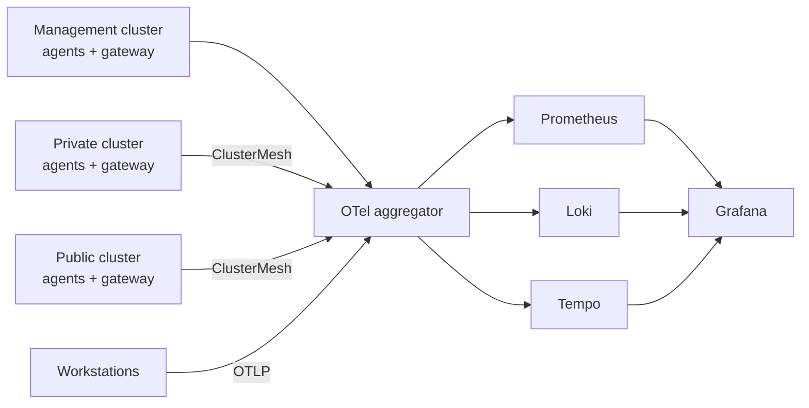

# Brad Evans

I'm a Site Reliability Engineer working in fintech. Most of my time goes on Kubernetes, observability through correlation and stateless developer experience.

My ideal stack is .NET, OpenTelemetry and AWS. Battlestation centred around [Atomic Linux (currently bluefin)](https://projectbluefin.io), vim, [mise](https://mise.jdx.dev) + [chezmoi](https://www.chezmoi.io), and [devpod](https://devpod.sh).

Demystifying secrets of the instrumentation in a codebase to unlock clear, correlated signals tickles my brain and is my North Star.

> *The observability of a service is only as good as its instrumentation.*

I'm currently obsessed with developer experience - workstation reproducibility, TTW (Time To Writing) and security through containerisation, templating and clever tooling. The building work associated with this thinking is in [devcontainer-images](https://github.com/bde-dev/devcontainer-images).

> *Experimenting with where agentic coding loops fit into this picture, and my [Tilt Exploration](https://github.com/bde-dev/tilt-demo) is the laboratory.*

## Homelab

I run a multi-cluster bare-metal Kubernetes platform at home. It is where I learn new concepts and tooling then put those learnings into practice.

### Topology

**In one statement** - An orchestrator cluster manages the deployment and reconciliation of *itself* as well as fanout feature clusters.

> *Some of my workloads contain sensitive personal information. Those workloads run on a `private-cluster` with the code in a private repository.*

[management-cluster](https://github.com/bde-dev/management-cluster): The platform cluster. Manages `AppProjects`, `ApplicationSets` and `Applications` to roll out shared common infrastructure across the fanout clusters such as DNS, secrets management, observability and more. A root app CR on `management-cluster` encapsulates their workloads in an app-of-apps pattern.

[public-cluster](https://github.com/bde-dev/public-cluster): public-facing workload `kustomize` manifests and their `Application` CRs.

### Design Choices

#### OS

All nodes across each cluster run [Talos Linux](https://www.talos.dev/). The nodes have been defined in [Omni](https://omni.siderolabs.com) cluster templates in Git so I can apply GitOps practices to the nodes my homelab runs on.

- Omni reconciles changes in cluster templates onto the machines.
- Upgrading a Talos version or a Kubernetes version is a PR in [talos-configs](https://github.com/bde-dev/talos-configs) propagated across the entire estate.

#### GitOps

ArgoCD lives on the `management-cluster` and deploys to fanout clusters using the app-of-apps pattern. Shared infrastructure is rolled out with `ApplicationSets`, so a new cluster gets the same baseline as the existing ones by being registered.

#### Networking and ClusterMesh

Cilium is the CNI on every cluster, with ClusterMesh joining them. A service marked global on one cluster is reachable by name from the others, which is what lets telemetry flow to a single place without exposing anything.

#### Observability

I have adopted the industry-recognised aggregator pattern for my OpenTelemetry setup. Each cluster gets an OTel Operator which deploys an Agent per node and a single Gateway for the cluster. The Gateways forward signal on to the aggregator collector which then fans out to Prometheus, Loki and Tempo, visualised and correlated in Grafana.

> *[Workstations](https://github.com/bde-dev/workstation-monitoring) ship to the same aggregator collector, so a slow laptop as well as a slow homelab pod show up in the same observability stack in Grafana.*

**How telemetry flows**

#### Monitoring Roadmap

Monitoring will be implemented to mirror industry standard SRE practices:

- Implementation of `spanmetrics` at the collector layers to be able to present `RED` metrics in Grafana
- Established SLIs, SLOs and error budgets across a selection of services against these `RED` metrics
- An alerting pipeline capturing deviations which notifies me on Discord or Slack
- Experiment with an agentic investigation into the root cause of these alerts

#### Data

CloudNativePG runs the Postgres databases which are persisted on a Synology NAS using the [synology-csi operator](https://github.com/SynologyOpenSource/synology-csi). The [Barman plugin](https://cloudnative-pg.io/plugin-barman-cloud/docs/intro/) manages and prunes the scheduled backups of these databases to Azure Blob.

#### Certificates, DNS and Secrets

cert-manager, external-dns and external-secrets handle certificates, DNS and credentials. Public facing services are exposed through Cloudflare Tunnels and `cloudflared`, offloading the internet-into-my-home edge management to Cloudflare. No port configuration on my home router.

#### Change Management

`renovate` deployed in `management-cluster` scans homelab-related repos for version bumps:

- `mise` tools
- `helm` charts
- deployment image pins in fanout cluster `kustomize` manifests
- Talos and Kubernetes upgrades

#### Container Images

I maintain a `harbor` deployment which serves the following purposes:

- pull-through proxy cache for the most common public registries in the case of a home internet outage or upstream accessibility issues. My workloads can pull from `harbor.bde-dev.net/dockerhub-proxy/cloudflared` if `docker.io/cloudflare/cloudflared` is unreachable. Secrets management ensures only permitted workloads can interact with `harbor`
- Home to my custom application images, deployed to the `private-cluster`
- [`devcontainer-images`](https://github.com/bde-dev/devcontainer-images) defines the golden devcontainer image bases and flavours, built with `mise`, so new apps go from idea to a running thing in minutes

## Convergence: Agentic Inner Loop

Coding agents are good at writing code and poor at knowing whether it works. The usual answer is to give them unit tests and mocks. I think the better answer, for services that run on Kubernetes, is to give them Kubernetes.

I'm building a reference rig around that idea:

- **A real cluster in the loop.** [Tilt](https://tilt.dev/) and [k3d](https://k3d.io/stable/) inside a dev container, so a change is built, deployed to a cluster, and running within seconds. The agent works against the same manifests, probes and networking the service will meet in production.

- **Telemetry as the feedback signal.** Services emit traces, metrics and logs over OTLP from the first run. An agent that can query those has evidence of what its change did, which is a stronger signal than a passing test.

- **Conventions enforced by the build.** A `dotnet new` template for .NET minimal APIs that carries OpenTelemetry wiring and coding standards that fail the build when broken. When an agent drifts from the house style, the build corrects it before a human reads the diff.

This is in progress. A .NET template will enforce code security and style, [tilt-demo](https://github.com/bde-dev/tilt-demo) is where the rig is taking shape, and [k3d-config](https://github.com/bde-dev/k3d-config) holds the cluster environments seeding the local Kubernetes loop.

## Labs

- [k3d-config](https://github.com/bde-dev/k3d-config): ready-made k3d environments for testing and exploration, including OpenTelemetry Operator and Prometheus labs.
- [otel-dotnet-docker-lab](https://github.com/bde-dev/otel-dotnet-docker-lab): OpenTelemetry in .NET, run under Docker.
- [dotnet-lab](https://github.com/bde-dev/dotnet-lab): where I keep my .NET sharp.

## Writing

I write at [blog.bde-dev.net](https://blog.bde-dev.net).
